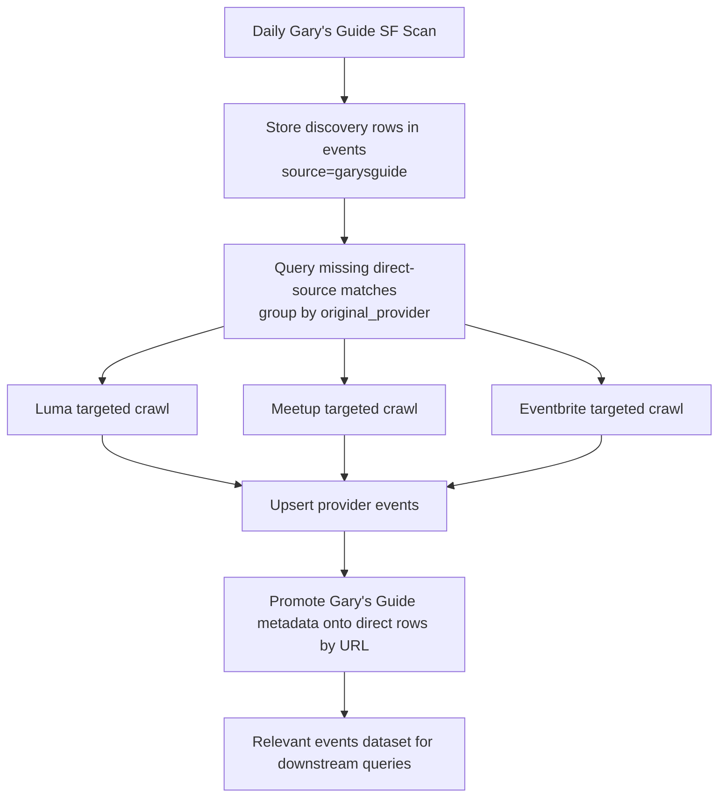

# Event Aggregator Pattern Design

## Overview

Gary's Guide acts as an **event aggregator** that collects events from multiple platforms (Luma, Meetup, Eventbrite, etc.) without directly scraping those platforms. This design document describes how we handle aggregated events to avoid duplicate scraping.

## Problem Statement

**Observation**: Gary's Guide lists events but redirects to other platforms for registration:
- `garysguide.com/events/abc123` → `gary.to/xyz456` → `luma.com/event-slug`
- `garysguide.com/events/def789` → `gary.to/pqr123` → `meetup.com/group/events/789`

**Challenge**: We already have crawlers for Luma and Meetup. We don't want to:
1. Re-scrape events from providers we already crawl
2. Parse individual event pages via Gary's Guide redirects
3. Duplicate data in the database

**Solution**: Treat Gary's Guide as metadata-only aggregator, store references to original providers, and let dedicated crawlers handle the details.

## Architecture

### Daily Discovery Pipeline

The right operating model is not "run Gary's Guide plus run every provider independently and hope overlap works out." It should be a two-stage daily pipeline:

1. Gary's Guide runs first as the discovery feed for SF.
2. Aggregator discoveries are stored with provider URL + provider name.
3. The system queries for Gary's Guide events whose provider URL does not yet exist as a direct-source event.
4. Provider crawlers run against that pending set first, then optionally do a broader catch-up crawl.
5. After provider ingestion, direct-source rows are enriched with Gary's Guide metadata by matching on `url`.



### Why This Architecture

- Gary's Guide is strongest as curated discovery, not authoritative event detail.
- Provider sites are strongest as authoritative detail, but expensive to crawl broadly every day.
- Matching on final provider `url` lets us avoid duplicate interpretation work and still retain Gary's Guide provenance.
- The database becomes the scheduling boundary: "what Gary's Guide found that we still need to enrich" is a query, not custom state.

### Data Model

New fields added to `Event` model:

```python
class Event(BaseModel):
    # ... existing fields ...

    # Aggregator metadata
    original_provider: Optional[str]        # "luma", "meetup", "eventbrite"
    aggregated_from: Optional[str]          # "garysguide"
    short_url: Optional[str]                # "http://gary.to/abc123"
    aggregator_detail_url: Optional[str]    # "https://garysguide.com/events/abc123"
```

### Database Schema (Migration 3)

```sql
-- New columns in events table
ALTER TABLE events ADD COLUMN original_provider TEXT;      -- luma.com, meetup.com
ALTER TABLE events ADD COLUMN aggregated_from TEXT;        -- garysguide
ALTER TABLE events ADD COLUMN short_url TEXT;              -- gary.to/abc123
ALTER TABLE events ADD COLUMN aggregator_detail_url TEXT;  -- Full Gary's Guide URL

-- Indexes for aggregator queries
CREATE INDEX idx_events_original_provider ON events(original_provider);
CREATE INDEX idx_events_aggregated_from ON events(aggregated_from);
```

### Crawler Behavior

#### Gary's Guide Crawler (Aggregator Mode)

**What it does**:
1. ✅ Scrapes Gary's Guide listing page
2. ✅ Visits Gary's Guide detail pages
3. ✅ Extracts metadata (title, date, location, description, image)
4. ✅ Resolves `gary.to` redirects to get final URL
5. ✅ Detects provider from final URL (luma.com → "luma")
6. ✅ Saves aggregator metadata WITHOUT visiting provider page

**What it does NOT do**:
1. ❌ Visit Luma/Meetup/Eventbrite event pages
2. ❌ Parse individual event details from providers
3. ❌ Scrape data we already get from dedicated crawlers

**Data saved**:
```json
{
  "eventId": "abc123",
  "source": "garysguide",
  "originalProvider": "luma",
  "aggregatedFrom": "garysguide",
  "url": "https://luma.com/event-slug",
  "shortUrl": "http://gary.to/xyz456",
  "aggregatorDetailUrl": "https://garysguide.com/events/abc123",
  "title": "Event Title from Gary's Guide",
  "dateStr": "Wed, Feb 21, 7:00 PM",
  "location": "Location from Gary's Guide",
  "description": "Description snippet...",
  "imageUrl": "https://...",
  "isAggregated": true,
  "scrapedAt": "2026-02-20T01:00:00Z"
}
```

#### Dedicated Crawlers (Luma, Meetup, etc.)

**Unchanged behavior**:
- Continue crawling their respective platforms
- Extract full event details
- Save with `source` = their platform name
- No awareness of aggregators

**Data saved**:
```json
{
  "eventId": "event-slug",
  "source": "luma",
  "url": "https://luma.com/event-slug",
  "title": "Full Event Title",
  "startDatetime": "2026-02-21T19:00:00Z",
  "location": "Full Address",
  "description": "Full description...",
  // ... all other fields
}
```

## Deduplication Strategy

### Current Approach (Basic)

Events are deduplicated by `(event_id, source)` UNIQUE constraint in SQLite.

**Result**:
- Gary's Guide events: `(abc123, garysguide)`
- Luma events: `(event-slug, luma)`
- **No collision** - stored as separate events

### Future Enhancement (Advanced)

Add smart deduplication to detect when aggregator event matches provider event:

1. **URL matching**: Compare `url` field
   - Gary's Guide: `url = "https://luma.com/event-slug"`
   - Luma crawler: `url = "https://luma.com/event-slug"`
   - **Match found** → Mark as duplicates

2. **Update logic**:
   - If Luma event exists, update it with Gary's Guide metadata:
     ```sql
     UPDATE events
     SET aggregated_from = 'garysguide',
         short_url = 'http://gary.to/xyz',
         aggregator_detail_url = 'https://garysguide.com/events/abc123'
     WHERE url = 'https://luma.com/event-slug' AND source = 'luma'
     ```

3. **Enrichment**: Use Gary's Guide as discovery mechanism
   - If Gary's Guide finds event we haven't crawled yet → flag for priority
   - If Gary's Guide has better title/description → merge data

### Recommended Daily Operation

For the SF daily run:

```text
02:00  Gary's Guide SF discovery run
02:10  Import discovery rows into SQLite
02:15  Query missing direct-source matches for luma / meetup / eventbrite
02:20  Run targeted provider crawls for missing URLs
03:00  Run metadata promotion by URL
03:05  Run downstream filters / exports
```

The key difference from the prior model is that provider runs are informed by discovery output. A full provider crawl is now fallback coverage, not the primary way to keep Gary's Guide events current.

## Provider Detection

Implemented in `extractProvider(url)` function:

```typescript
function extractProvider(url: string): string | null {
  const hostname = new URL(url).hostname.toLowerCase()

  const providerMap = {
    'luma.com': 'luma',
    'lu.ma': 'luma',
    'meetup.com': 'meetup',
    'eventbrite.com': 'eventbrite',
    'aicamp.ai': 'aicamp',
    'startupgrind.com': 'startupgrind',
    'partiful.com': 'partiful',
    // ... more providers
  }

  return providerMap[hostname] || hostname
}
```

**Supported providers**:
- luma.com, lu.ma → "luma"
- meetup.com → "meetup"
- eventbrite.com → "eventbrite"
- aicamp.ai → "aicamp"
- startupgrind.com → "startupgrind"
- partiful.com → "partiful"
- hopin.com → "hopin"

**Fallback**: Returns hostname if not recognized

## Query Patterns

### Find all aggregated events
```sql
SELECT * FROM events
WHERE aggregated_from IS NOT NULL;
```

### Find events from specific provider via Gary's Guide
```sql
SELECT * FROM events
WHERE aggregated_from = 'garysguide'
  AND original_provider = 'luma';
```

### Find events with both aggregator and direct source
```sql
SELECT
  g.title AS gary_title,
  g.url,
  g.short_url,
  l.title AS luma_title,
  l.start_datetime
FROM events g
INNER JOIN events l ON g.url = l.url
WHERE g.source = 'garysguide'
  AND l.source = 'luma';
```

### Find events only found via aggregator (not yet crawled directly)
```sql
SELECT * FROM events
WHERE source = 'garysguide'
  AND url NOT IN (
    SELECT url FROM events
    WHERE source != 'garysguide'
  );
```

### Find pending provider work for daily enrichment
```sql
SELECT *
FROM events
WHERE source = 'garysguide'
  AND original_provider = 'luma'
  AND NOT EXISTS (
    SELECT 1
    FROM events direct
    WHERE direct.url = events.url
      AND direct.source != events.source
  )
ORDER BY start_datetime;
```

## Benefits

### 1. **Avoids Duplicate Scraping**
- Gary's Guide crawler doesn't re-parse Luma/Meetup pages
- Dedicated crawlers handle their platforms efficiently
- Reduces compute costs and API load

### 2. **Metadata Enrichment**
- Gary's Guide provides curation/categorization
- Short URLs (gary.to) are useful for tracking
- Can identify popular events (featured on Gary's Guide)

### 3. **Discovery Mechanism**
- Gary's Guide may list events from platforms we don't crawl yet
- Can identify new event platforms to add crawlers for
- Provides event coverage across multiple platforms

### 4. **Data Quality**
- Full event details come from authoritative source (provider)
- Gary's Guide metadata acts as secondary verification
- Can detect discrepancies (different titles/dates)

## Testing

### Local Testing

```bash
cd src/apify/garysguide-crawler

# Test with small limit
apify run --input-file=inputs/test-10.json

# Check output
cat storage/datasets/default/*.json | jq '.originalProvider' | sort | uniq -c
```

**Expected output**:
```json
{
  "eventId": "abc123",
  "source": "garysguide",
  "originalProvider": "luma",
  "url": "https://luma.com/event-slug",
  "shortUrl": "http://gary.to/xyz",
  "isAggregated": true
}
```

### Database Testing

```python
from events_agent.database.connection import DatabaseConnection
from events_agent.repositories.sqlite_repository import SQLiteEventRepository

db = DatabaseConnection("data/events.db")
repo = SQLiteEventRepository(db)

# Count aggregated events
cursor = db.execute(
    "SELECT COUNT(*) FROM events WHERE aggregated_from = 'garysguide'"
)
print(f"Aggregated events: {cursor.fetchone()[0]}")

# List providers
cursor = db.execute(
    """
    SELECT original_provider, COUNT(*) as count
    FROM events
    WHERE aggregated_from = 'garysguide'
    GROUP BY original_provider
    """
)
for row in cursor.fetchall():
    print(f"{row['original_provider']}: {row['count']}")
```

### Integration Testing

1. **Run Gary's Guide crawler**: Collect aggregated events
2. **Run Luma crawler**: Collect events directly from Luma
3. **Compare URLs**: Find matching events
4. **Verify no duplication**: Different `(event_id, source)` combinations

## Future Enhancements

### 1. Smart Deduplication
- Match aggregator events with provider events by URL
- Merge metadata from both sources
- Flag high-confidence matches

### 2. Priority Crawling
- Use Gary's Guide as discovery feed
- Prioritize crawling events found via aggregator
- Reduce lag time for new events

### 3. Multi-Aggregator Support
- Extend pattern to other aggregators (Eventbrite Discover, Meetup Feed)
- Standardize aggregator metadata fields
- Track multiple aggregators per event

### 4. Provider Coverage Analysis
```sql
-- Find providers we should add crawlers for
SELECT original_provider, COUNT(*) as event_count
FROM events
WHERE aggregated_from = 'garysguide'
  AND original_provider NOT IN ('luma', 'meetup', 'eventbrite', 'fever')
GROUP BY original_provider
ORDER BY event_count DESC;
```

## Migration Guide

### Existing Database

Run migration to add aggregator fields:
```python
from events_agent.database.connection import DatabaseConnection
from events_agent.database.schema import SchemaManager

db = DatabaseConnection("data/events.db")
schema = SchemaManager(db)
schema.initialize_schema()  # Applies migration 3
```

### Existing Crawlers

No changes required for:
- Luma crawler
- Meetup crawler
- Eventbrite crawler
- Fever crawler

These continue to work as before.

### Gary's Guide Crawler

**Before**: Scraped individual event pages
**After**: Collects aggregator metadata only

Deploy updated crawler to Apify:
```bash
cd src/apify/garysguide-crawler
apify push
```

## Conclusion

The aggregator pattern allows Gary's Guide to enhance our event discovery without duplicating scraping efforts. By storing metadata references and detecting providers, we maintain data quality while reducing costs.

**Key Principle**: Aggregators provide metadata and references; dedicated crawlers provide full details.
