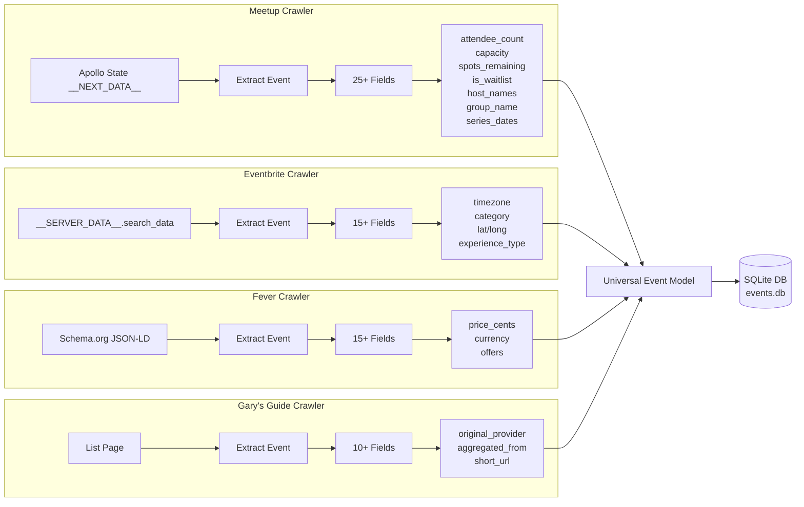

# Crawler Data Mapping

**Version**: 1.0
**Date**: 2026-02-19

## Overview

This document shows what data each crawler currently collects and how it maps to the universal data model.

## Data Collection Matrix

| Field Category | Field Name | Meetup | Eventbrite | Fever | Gary's Guide | Notes |
|----------------|------------|--------|------------|-------|--------------|-------|
| **Core Identity** |
| | event_id | ✅ | ✅ | ✅ | ✅ | All sources |
| | source | ✅ | ✅ | ✅ | ✅ | All sources |
| | url | ✅ | ✅ | ✅ | ✅ | All sources |
| | title | ✅ | ✅ | ✅ | ✅ | All sources |
| | start_datetime | ✅ | ✅ | ✅ | ✅ | All sources |
| **Event Details** |
| | description | ✅ | ✅ | ✅ | ❌ | Gary's Guide: list page only |
| | end_datetime | ✅ | ✅ | ✅ | ❌ | Eventbrite: optional |
| | duration_minutes | ❌ | ❌ | ❌ | ❌ | Not collected yet |
| | is_online | ✅ | ✅ | ✅ | ❌ | |
| | timezone | ❌ | ✅ | ❌ | ❌ | Only Eventbrite |
| **Location** |
| | location_name | ✅ (venue) | ✅ | ✅ | ✅ | |
| | location_address | ✅ (address) | ✅ | ✅ | ❌ | |
| | city | ❌ | ✅ | ✅ | ❌ | Meetup: in address string |
| | state | ❌ | ✅ | ✅ | ❌ | Meetup: in address string |
| | country | ❌ | ❌ | ❌ | ❌ | Not collected yet |
| | latitude | ❌ | ✅ | ✅ | ❌ | |
| | longitude | ❌ | ✅ | ✅ | ❌ | |
| | directions | ❌ | ❌ | ❌ | ❌ | Not collected yet |
| **Pricing** |
| | is_free | ✅ (derived) | ✅ (derived) | ✅ (derived) | ❌ | |
| | price_cents | ✅ | ❌ | ✅ | ❌ | Eventbrite: not in search results |
| | currency | ✅ (USD default) | ❌ | ✅ | ❌ | |
| | min_price_cents | ✅ | ❌ | ❌ | ❌ | Only Meetup (tiered) |
| | max_price_cents | ✅ | ❌ | ❌ | ❌ | Only Meetup (tiered) |
| | fee_amount | ❌ | ❌ | ❌ | ❌ | Not collected yet |
| | fee_required | ❌ | ❌ | ❌ | ❌ | Not collected yet |
| | payment_methods | ❌ | ❌ | ❌ | ❌ | Not collected yet |
| **Capacity & Registration** |
| | attendee_count | ✅ | ❌ | ❌ | ❌ | Only Meetup |
| | capacity | ✅ (maxTickets) | ❌ | ❌ | ❌ | Only Meetup |
| | spots_remaining | ✅ | ❌ | ❌ | ❌ | Only Meetup |
| | registration_status | ✅ (derived) | ❌ | ❌ | ❌ | Meetup: from registrationClosed |
| | is_waitlist | ✅ | ❌ | ❌ | ❌ | Only Meetup |
| | is_sold_out | ✅ (derived) | ❌ | ❌ | ❌ | Meetup: spots_remaining == 0 |
| | registration_url | ❌ | ❌ | ❌ | ❌ | Not collected yet |
| | registration_closes_at | ❌ | ❌ | ❌ | ❌ | Not collected yet |
| **Organizer & Host** |
| | organizer_name | ✅ (group) | ❌ | ❌ | ❌ | Meetup only |
| | organizer_url | ✅ (groupUrl) | ❌ | ❌ | ❌ | Meetup only |
| | host_names | ✅ (hosts array) | ❌ | ❌ | ❌ | Meetup: can have multiple |
| | host_bio | ❌ | ❌ | ❌ | ❌ | Not collected yet |
| **Group (Meetup)** |
| | group_name | ✅ | ❌ | ❌ | ❌ | Meetup only |
| | group_url | ✅ | ❌ | ❌ | ❌ | Meetup only |
| | group_rating | ❌ | ❌ | ❌ | ❌ | Not in search results |
| | group_review_count | ❌ | ❌ | ❌ | ❌ | Not in search results |
| **Content & Media** |
| | image_url | ✅ (cover) | ✅ | ✅ | ✅ | All sources |
| | images | ❌ | ❌ | ❌ | ❌ | Not collected yet |
| | video_url | ❌ | ❌ | ❌ | ❌ | Not collected yet |
| | ai_summary | ❌ | ❌ | ❌ | ❌ | Future enhancement |
| **Categorization** |
| | experience_type | ❌ | ✅ (inferred) | ✅ (inferred) | ❌ | Inferred from tags/title |
| | category | ❌ | ✅ | ❌ | ❌ | Eventbrite: from tags |
| | tags | ✅ | ❌ | ❌ | ❌ | Meetup only |
| | topics | ❌ | ❌ | ❌ | ❌ | Not collected yet |
| **Event Series** |
| | is_recurring | ✅ (derived) | ❌ | ❌ | ❌ | Meetup: has eventSeriesDates |
| | series_id | ❌ | ❌ | ❌ | ❌ | Not collected yet |
| | series_dates | ✅ (eventSeriesDates) | ❌ | ❌ | ❌ | Meetup only |
| | recurrence_pattern | ❌ | ❌ | ❌ | ❌ | Not collected yet |
| | next_occurrence_date | ❌ | ❌ | ❌ | ❌ | Not collected yet |
| **Domain-Specific** |
| | chef_name | ❌ | ❌ | ❌ | ❌ | For Cozymeal crawler |
| | chef_rating | ❌ | ❌ | ❌ | ❌ | For Cozymeal crawler |
| | chef_bio | ❌ | ❌ | ❌ | ❌ | For Cozymeal crawler |
| | skill_level | ❌ | ❌ | ❌ | ❌ | For Cozymeal crawler |
| | cuisine_type | ❌ | ❌ | ❌ | ❌ | For Cozymeal crawler |
| | performer_names | ❌ | ❌ | ❌ | ❌ | For Songkick/music crawlers |
| | genre | ❌ | ❌ | ❌ | ❌ | For Songkick/music crawlers |
| | team_names | ❌ | ❌ | ❌ | ❌ | For sports crawlers |
| | league | ❌ | ❌ | ❌ | ❌ | For sports crawlers |
| **Ratings & Reviews** |
| | rating | ❌ | ❌ | ❌ | ❌ | Not collected yet |
| | review_count | ❌ | ❌ | ❌ | ❌ | Not collected yet |
| **Aggregator Metadata** |
| | original_provider | ❌ | ❌ | ❌ | ✅ | Gary's Guide only |
| | aggregated_from | ❌ | ❌ | ❌ | ✅ | Gary's Guide only |
| | short_url | ❌ | ❌ | ❌ | ✅ | Gary's Guide only |
| | aggregator_detail_url | ❌ | ❌ | ❌ | ✅ | Gary's Guide only |
| **System Metadata** |
| | crawled_at | ✅ | ✅ | ✅ | ✅ | Auto-generated |
| | detail_crawled | ✅ | ✅ | ✅ | ✅ | All sources |
| | last_updated_at | ❌ | ❌ | ❌ | ❌ | Not implemented yet |

## Data Collection Summary

| Crawler | Fields Collected | Unique Fields | Data Quality |
|---------|------------------|---------------|--------------|
| **Meetup** | 25+ | attendee_count, capacity, spots_remaining, is_waitlist, host_names, group data, series_dates | ⭐⭐⭐⭐⭐ Rich |
| **Eventbrite** | 15+ | timezone, category, latitude, longitude | ⭐⭐⭐⭐ Good |
| **Fever** | 15+ | price_cents, Schema.org structured data | ⭐⭐⭐⭐ Good |
| **Gary's Guide** | 10+ | original_provider, aggregated_from, short_url | ⭐⭐⭐ Basic |

## Data Flow Diagram



## Crawler-Specific Notes

### Meetup Crawler (TypeScript)

**Data Source**: Next.js Apollo State (`__NEXT_DATA__`)

**Strengths**:
- ✅ Most comprehensive data (25+ fields)
- ✅ Multiple hosts support
- ✅ Event series data
- ✅ Registration status (waitlist, closed)
- ✅ Capacity and attendance tracking

**Limitations**:
- ❌ No explicit timezone (uses local time)
- ❌ No lat/long coordinates
- ❌ No structured city/state fields

**Example Data**:
```json
{
  "url": "https://meetup.com/event/123",
  "title": "Python NYC Meetup",
  "group": "NYC Python",
  "dateTime": "2026-02-20T18:00:00Z",
  "hosts": ["Alice", "Bob"],
  "attendees": "45",
  "maxTickets": 100,
  "spotsLeft": 55,
  "price": 0,
  "waitlist": false,
  "registrationClosed": false,
  "eventSeriesDates": ["2026-02-20T18:00:00Z", "2026-02-27T18:00:00Z"]
}
```

### Eventbrite Crawler (Python)

**Data Source**: `window.__SERVER_DATA__.search_data.events`

**Strengths**:
- ✅ Timezone information
- ✅ Geo coordinates (lat/long)
- ✅ Structured address (city, state)
- ✅ Category from tags

**Limitations**:
- ❌ No price in search results (detail page only)
- ❌ No attendance/capacity data
- ❌ No host information

**Example Data**:
```json
{
  "id": "123456789",
  "name": "Tech Conference NYC",
  "url": "https://eventbrite.com/e/123456789",
  "start_date": "2026-02-20",
  "start_time": "18:00",
  "timezone": "America/New_York",
  "primary_venue": {
    "name": "Tech Hub NYC",
    "address": {
      "address_1": "123 Broadway",
      "city": "New York",
      "region": "NY",
      "latitude": "40.7128",
      "longitude": "-74.0060"
    }
  },
  "is_online_event": false,
  "tags": [
    {"prefix": "EventbriteCategory", "display_name": "Business & Professional"},
    {"prefix": "EventbriteFormat", "display_name": "Conference"}
  ],
  "image": {"url": "https://cdn.eventbrite.com/image.jpg"}
}
```

### Fever Crawler (Python)

**Data Source**: Schema.org JSON-LD structured data

**Strengths**:
- ✅ Pricing information (offers)
- ✅ Geo coordinates
- ✅ Structured data (Schema.org standard)
- ✅ Experience type inference

**Limitations**:
- ❌ No attendance/capacity data
- ❌ No host information
- ❌ No event series data

**Example Data**:
```json
{
  "@type": "Event",
  "name": "Candlelight Concert",
  "startDate": "2026-02-20T19:00:00-05:00",
  "endDate": "2026-02-20T21:00:00-05:00",
  "location": {
    "@type": "Place",
    "name": "St. Patrick's Cathedral",
    "address": {
      "@type": "PostalAddress",
      "streetAddress": "5th Ave",
      "addressLocality": "New York",
      "addressRegion": "NY"
    },
    "geo": {
      "@type": "GeoCoordinates",
      "latitude": 40.7585,
      "longitude": -73.9760
    }
  },
  "offers": [{
    "@type": "Offer",
    "price": "35.00",
    "priceCurrency": "USD"
  }],
  "image": "https://cdn.feverup.com/image.jpg"
}
```

### Gary's Guide Crawler (TypeScript/Planned)

**Data Source**: List page + redirect resolution

**Strengths**:
- ✅ Aggregator metadata (original_provider)
- ✅ Short URLs (gary.to/xyz)
- ✅ Discovery mechanism for events across platforms

**Limitations**:
- ❌ Minimal event details (title, date, image)
- ❌ No pricing, capacity, or attendance
- ❌ Detail page required for full data

**Example Data**:
```json
{
  "url": "https://luma.com/event/evt-abc123",
  "title": "AI Meetup",
  "dateStr": "Feb 20, 2026",
  "location": "NYC",
  "imageUrl": "https://cdn.luma.com/image.jpg",
  "shortUrl": "http://gary.to/xyz123",
  "aggregator_detail_url": "https://garysguide.com/event/123",
  "original_provider": "luma.com"
}
```

## Field Coverage by Category

| Category | Meetup | Eventbrite | Fever | Gary's Guide |
|----------|--------|------------|-------|--------------|
| **Core Identity** | 100% | 100% | 100% | 100% |
| **Event Details** | 60% | 80% | 60% | 20% |
| **Location** | 40% | 90% | 80% | 30% |
| **Pricing** | 60% | 0% | 80% | 0% |
| **Capacity/Registration** | 100% | 0% | 0% | 0% |
| **Organizer/Host** | 80% | 0% | 0% | 0% |
| **Media** | 30% | 30% | 30% | 30% |
| **Categorization** | 40% | 60% | 40% | 0% |
| **Event Series** | 80% | 0% | 0% | 0% |
| **Aggregator** | 0% | 0% | 0% | 100% |

## Recommendations

### Priority 1: Enhance Existing Crawlers
1. **Meetup**: Add city/state extraction from address string
2. **Eventbrite**: Implement detail page crawler for price data
3. **Fever**: Add fallback for events without Schema.org data

### Priority 2: New Fields
1. **All crawlers**: Add `timezone` field
2. **All crawlers**: Add `duration_minutes` calculation
3. **Meetup**: Extract group rating/reviews from detail page

### Priority 3: Future Enhancements
1. **AI Summary**: Generate summaries using LLM
2. **Video URLs**: Extract from detail pages
3. **Additional images**: Collect image galleries
4. **Ratings**: Aggregate ratings from multiple sources
