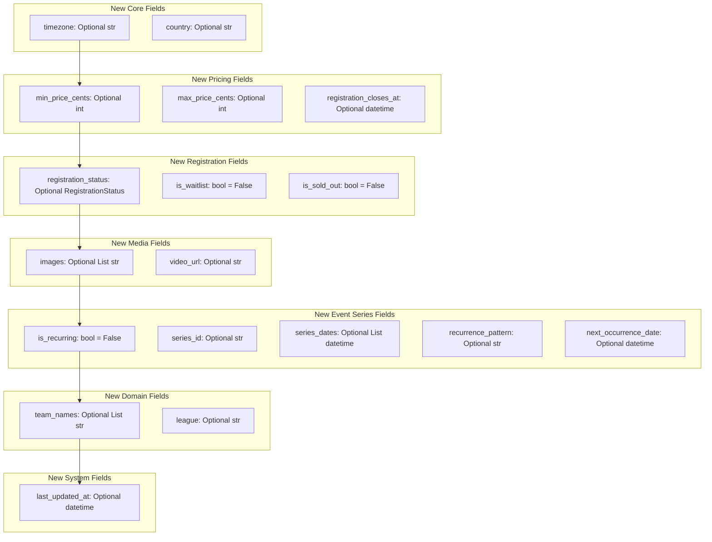
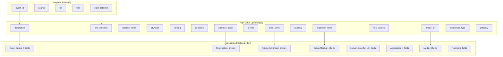
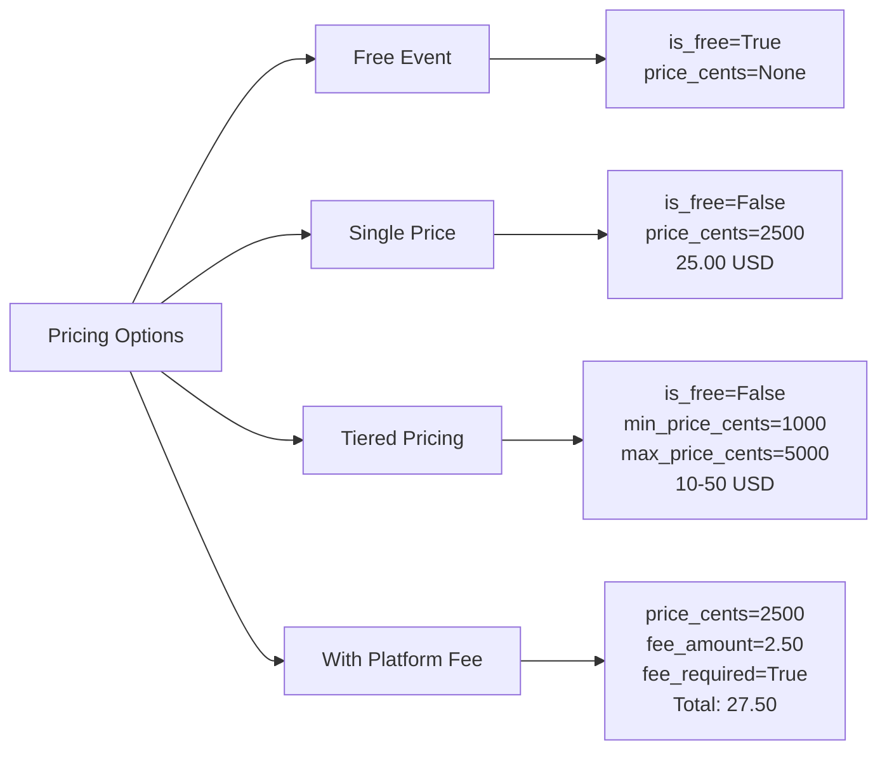
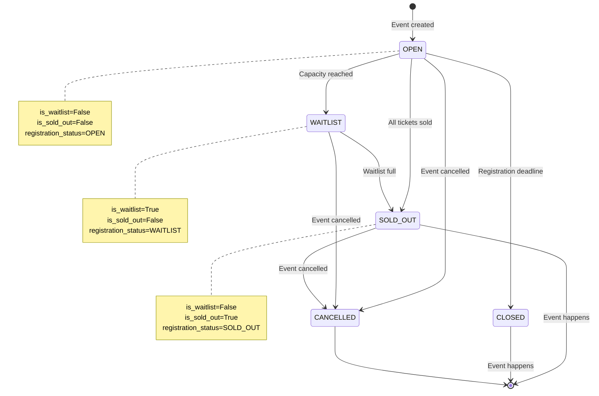
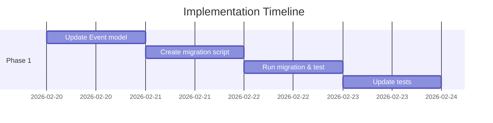
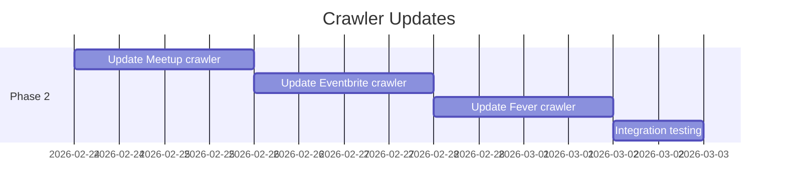

# Universal Data Model - Review Summary

**Version**: 2.0
**Date**: 2026-02-19
**Status**: 🔍 Awaiting Review

## Executive Summary

Designed a comprehensive universal data model that:
- ✅ Supports **all current crawlers** (Meetup, Eventbrite, Fever, Gary's Guide)
- ✅ **50+ optional fields** for rich event data
- ✅ **Only 5 required fields** (easy to implement)
- ✅ **Type-safe** with Pydantic validation
- ✅ **Aggregator pattern** native support
- ✅ **Event series** support for recurring events
- ✅ **Registration status** tracking (waitlist, sold out, etc.)
- ✅ **Backward compatible** with minimal breaking changes

## Key Changes from Current Model

### 1. New Fields (23 fields)



### 2. Field Changes

| Current Field | New Field | Change Type | Impact |
|--------------|-----------|-------------|---------|
| `host_name: Optional[str]` | `host_names: Optional[List[str]]` | **Type change** | ⚠️ Breaking (but backward compatible) |

**Migration Strategy for `host_name` → `host_names`**:
```python
# Backward compatible setter
@field_validator('host_names', mode='before')
@classmethod
def convert_host_name(cls, v):
    # If single string provided, convert to list
    if isinstance(v, str):
        return [v]
    return v
```

### 3. New Enums

```python
class RegistrationStatus(str, Enum):
    OPEN = "open"              # Registration is open
    CLOSED = "closed"          # Registration closed
    SOLD_OUT = "sold_out"      # Event sold out
    WAITLIST = "waitlist"      # Waitlist only
    PAST = "past"              # Event already happened
    CANCELLED = "cancelled"    # Event cancelled
```

## Visual Model Overview



## Data Quality Comparison

| Crawler | Required Fields | Optional Fields | Data Richness | Example |
|---------|----------------|-----------------|---------------|---------|
| **Meetup** | 5/5 (100%) | 25+ | ⭐⭐⭐⭐⭐ | attendee_count, capacity, spots_remaining, waitlist, series |
| **Eventbrite** | 5/5 (100%) | 15+ | ⭐⭐⭐⭐ | timezone, lat/long, category, structured address |
| **Fever** | 5/5 (100%) | 15+ | ⭐⭐⭐⭐ | price, offers, Schema.org data |
| **Gary's Guide** | 5/5 (100%) | 10+ | ⭐⭐⭐ | aggregator metadata, original_provider |

## Pricing Model Flexibility



**Examples**:
- **Free**: `is_free=True`, `price_cents=None`
- **Single price**: `is_free=False`, `price_cents=2500` (= $25.00)
- **Tiered**: `min_price_cents=1000`, `max_price_cents=5000` (= $10-$50)
- **With fees**: `price_cents=2500`, `fee_amount=2.50` (= $25 + $2.50 fee)

## Registration Status Flow



## Database Schema Changes

### Migration SQL (SQLite)

```sql
-- Migration 4: Universal Data Model v2.0
-- Add new fields to events table

-- Core fields
ALTER TABLE events ADD COLUMN timezone TEXT;
ALTER TABLE events ADD COLUMN country TEXT;

-- Pricing fields
ALTER TABLE events ADD COLUMN min_price_cents INTEGER;
ALTER TABLE events ADD COLUMN max_price_cents INTEGER;
ALTER TABLE events ADD COLUMN registration_closes_at TEXT; -- ISO 8601

-- Registration fields
ALTER TABLE events ADD COLUMN registration_status TEXT;
ALTER TABLE events ADD COLUMN is_waitlist INTEGER DEFAULT 0;
ALTER TABLE events ADD COLUMN is_sold_out INTEGER DEFAULT 0;

-- Media fields
ALTER TABLE events ADD COLUMN images TEXT; -- JSON array
ALTER TABLE events ADD COLUMN video_url TEXT;

-- Event series fields
ALTER TABLE events ADD COLUMN is_recurring INTEGER DEFAULT 0;
ALTER TABLE events ADD COLUMN series_id TEXT;
ALTER TABLE events ADD COLUMN series_dates TEXT; -- JSON array of ISO 8601 dates
ALTER TABLE events ADD COLUMN recurrence_pattern TEXT;
ALTER TABLE events ADD COLUMN next_occurrence_date TEXT; -- ISO 8601

-- Domain-specific fields
ALTER TABLE events ADD COLUMN team_names TEXT; -- JSON array
ALTER TABLE events ADD COLUMN league TEXT;

-- System fields
ALTER TABLE events ADD COLUMN last_updated_at TEXT; -- ISO 8601

-- Rename host_name to host_names (requires data migration)
-- Step 1: Add new column
ALTER TABLE events ADD COLUMN host_names TEXT; -- JSON array

-- Step 2: Migrate data
UPDATE events
SET host_names = CASE
    WHEN host_name IS NOT NULL THEN '["' || host_name || '"]'
    ELSE NULL
END;

-- Step 3: Drop old column (optional, can keep for backward compatibility)
-- ALTER TABLE events DROP COLUMN host_name;

-- Add indexes for new query patterns
CREATE INDEX idx_events_registration_status ON events(registration_status);
CREATE INDEX idx_events_is_recurring ON events(is_recurring);
CREATE INDEX idx_events_series_id ON events(series_id);
CREATE INDEX idx_events_timezone ON events(timezone);
```

### Database Impact

- **New columns**: 17 (all optional, backward compatible)
- **Index changes**: 4 new indexes
- **Data migration**: Only `host_name` → `host_names` requires migration
- **Storage impact**: ~10-20% increase (mostly NULL values)

## Implementation Plan

### Phase 1: Model & Database (Week 1)


**Tasks**:
1. ✅ Design review (this document)
2. ⬜ Update `models/event.py` with new fields
3. ⬜ Create migration script `migrations/004_universal_model_v2.sql`
4. ⬜ Run migration on `data/events.db`
5. ⬜ Update `SQLiteEventRepository` for new fields
6. ⬜ Add tests for new field validation

### Phase 2: Crawler Updates (Week 2)


**Tasks**:
1. ⬜ Update Meetup crawler to use new fields
2. ⬜ Update Eventbrite crawler to use new fields
3. ⬜ Update Fever crawler to use new fields
4. ⬜ Update Gary's Guide crawler (when implemented)
5. ⬜ Integration testing with real data

### Phase 3: Documentation (Week 3)
**Tasks**:
1. ⬜ Update README.md
2. ⬜ Update CLAUDE.md
3. ⬜ Add API documentation
4. ⬜ Create data dictionary

## Review Questions

### 1. Required vs Optional Fields
**Question**: Is having only 5 required fields appropriate?
- **Pros**: Easy to implement new crawlers, flexible
- **Cons**: More NULL values in database
- **Recommendation**: Keep minimal required fields

**Current required**: `event_id`, `source`, `url`, `title`, `start_datetime`

**Should we make `location_name` or `city` required?**
- No - some events are "TBD location" or online-only

### 2. Host Name Change
**Question**: Is changing `host_name: str` to `host_names: List[str]` acceptable?

**Impact**:
- ⚠️ Breaking change for existing code
- ✅ Backward compatible with validator
- ✅ Supports events with multiple hosts (common in Meetup)

**Recommendation**: Implement with backward compatibility
```python
@field_validator('host_names', mode='before')
def convert_host_name(cls, v):
    if isinstance(v, str):
        return [v]  # Auto-convert single string to list
    return v
```

### 3. Pricing Model
**Question**: Does the pricing model cover all cases?

**Current support**:
- ✅ Free events
- ✅ Single price
- ✅ Tiered pricing (min/max)
- ✅ Platform fees
- ❓ Donation-based (pay what you want)
- ❓ Early bird pricing

**Recommendation**: Current model is sufficient. Future: add `pricing_type` enum if needed.

### 4. Registration Status
**Question**: Is the `RegistrationStatus` enum complete?

**Current values**:
- `OPEN`, `CLOSED`, `SOLD_OUT`, `WAITLIST`, `PAST`, `CANCELLED`

**Missing**:
- ❓ `REQUIRES_APPROVAL` (for private events)
- ❓ `INVITE_ONLY`

**Recommendation**: Add if needed by specific crawler.

### 5. Event Series
**Question**: Do the series fields cover all use cases?

**Current fields**:
- `is_recurring: bool`
- `series_id: str` (links events in same series)
- `series_dates: List[datetime]` (upcoming dates)
- `recurrence_pattern: str` (human-readable description)
- `next_occurrence_date: datetime`

**Missing**:
- ❓ RRULE (RFC 5545 recurrence rule)

**Recommendation**: Current model is sufficient for now.

### 6. Missing Fields
**Question**: Are we missing any important fields?

**Suggested additions**:
- ❓ `min_age: Optional[int]` (age restrictions)
- ❓ `max_age: Optional[int]`
- ❓ `dress_code: Optional[str]`
- ❓ `parking_info: Optional[str]`
- ❓ `accessibility: Optional[str]`
- ❓ `language: Optional[str]`

**Recommendation**: Add in Phase 3 if needed by crawlers.

### 7. Data Quality
**Question**: How do we handle incomplete/inconsistent data?

**Strategies**:
1. **Validation**: Pydantic validators ensure type safety
2. **Defaults**: Sensible defaults for boolean fields
3. **Optional**: Most fields are optional (NULL in DB)
4. **Enrichment**: Future AI summary can fill gaps

**Recommendation**: Accept incomplete data, enrich over time.

## Success Metrics

After implementation, we should see:

| Metric | Current | Target | Status |
|--------|---------|--------|--------|
| **Required field coverage** | 100% | 100% | ✅ |
| **Optional field coverage** | ~40% | ~60% | 🎯 |
| **Data quality score** | 3.5/5 | 4.0/5 | 🎯 |
| **Crawler compatibility** | 4/4 | 6/6 | 🎯 |
| **Database migrations** | 3 | 4 | 🎯 |
| **Test coverage** | 93% | 95% | 🎯 |

## Next Steps

### Immediate (This Week)
1. ✅ **Review this document** - Validate design decisions
2. ⬜ **Approve or suggest changes** - Address review questions
3. ⬜ **Prioritize fields** - Which new fields to implement first?

### Short Term (Week 2)
1. ⬜ **Update Event model** - Implement approved changes
2. ⬜ **Create migration** - Database schema updates
3. ⬜ **Update tests** - Add validation tests

### Long Term (Week 3-4)
1. ⬜ **Update crawlers** - Map to new fields
2. ⬜ **Documentation** - Update all docs
3. ⬜ **Integration testing** - Verify end-to-end flow

## Appendix: Complete Field List

**Total fields**: 55+

**By category**:
- Core Identity: 5 (required)
- Event Details: 5
- Location: 8
- Pricing: 8
- Capacity & Registration: 8
- Organizer & Host: 4
- Group: 4
- Content & Media: 4
- Categorization: 4
- Event Series: 5
- Domain-Specific: 10
- Ratings: 2
- Aggregator: 4
- System: 3

---

## Decision Required

**Please review and approve**:
1. ✅ / ❌ Overall data model design
2. ✅ / ❌ Field additions (23 new fields)
3. ✅ / ❌ Field changes (`host_name` → `host_names`)
4. ✅ / ❌ Pricing model (free, single, tiered, fees)
5. ✅ / ❌ Registration status enum
6. ✅ / ❌ Event series fields
7. ✅ / ❌ Database migration plan

**Questions / Concerns**:
- [ ] List any questions or concerns here
- [ ] Suggest alternative approaches
- [ ] Identify missing requirements
