# Universal Event Data Model

**Version**: 2.0
**Date**: 2026-02-19
**Status**: Design Review

## Overview

This document defines a comprehensive, universal data model for all event crawlers (Eventbrite, Fever, Meetup, Luma, Gary's Guide, etc.). The model normalizes data from heterogeneous sources into a consistent schema.

## Design Principles

1. **Source Agnostic**: Works for all event platforms (Meetup, Luma, Eventbrite, Fever, etc.)
2. **Required Minimal**: Only 4 required fields (event_id, source, url, title, start_datetime)
3. **Rich Optional Fields**: 50+ optional fields for platform-specific data
4. **Type Safety**: Pydantic validation with strict types
5. **Backward Compatible**: Extends current model without breaking changes
6. **Aggregator Support**: Native support for aggregator pattern (Gary's Guide)
7. **Event Series**: Support for recurring/series events
8. **Registration State**: Waitlist, capacity, registration status

## Data Model Architecture

```mermaid
graph TB
    subgraph "Core Identity"
        A[event_id: str] --> B[source: EventSource]
        B --> C[url: HttpUrl]
        C --> D[title: str]
        D --> E[start_datetime: datetime]
    end

    subgraph "Event Details"
        F[description: Optional str]
        G[end_datetime: Optional datetime]
        H[duration_minutes: Optional int]
        I[is_online: bool = False]
    end

    subgraph "Location"
        J[location_name: Optional str]
        K[location_address: Optional str]
        L[city: Optional str]
        M[state: Optional str]
        N[country: Optional str]
        O[latitude: Optional float]
        P[longitude: Optional float]
        Q[directions: Optional str]
    end

    subgraph "Pricing"
        R[is_free: bool = True]
        S[price_cents: Optional int]
        T[currency: str = USD]
        U[min_price_cents: Optional int]
        V[max_price_cents: Optional int]
        W[fee_amount: Optional float]
        X[fee_required: Optional bool]
        Y[payment_methods: Optional str]
    end

    subgraph "Capacity & Registration"
        Z[attendee_count: Optional int]
        AA[capacity: Optional int]
        AB[spots_remaining: Optional int]
        AC[registration_status: Optional RegistrationStatus]
        AD[is_waitlist: bool = False]
        AE[is_sold_out: bool = False]
        AF[registration_url: Optional str]
    end

    subgraph "Organizer & Host"
        AG[organizer_name: Optional str]
        AH[organizer_url: Optional HttpUrl]
        AI[host_names: Optional List str]
        AJ[host_bio: Optional str]
    end

    subgraph "Group (Meetup-specific)"
        AK[group_name: Optional str]
        AL[group_url: Optional HttpUrl]
        AM[group_rating: Optional float]
        AN[group_review_count: Optional int]
    end

    subgraph "Content & Media"
        AO[image_url: Optional str]
        AP[images: Optional List str]
        AQ[video_url: Optional str]
        AR[ai_summary: Optional str]
    end

    subgraph "Categorization"
        AS[experience_type: Optional str]
        AT[category: Optional str]
        AU[tags: Optional List str]
        AV[topics: Optional List str]
    end

    subgraph "Event Series"
        AW[is_recurring: bool = False]
        AX[series_id: Optional str]
        AY[series_dates: Optional List datetime]
        AZ[recurrence_pattern: Optional str]
    end

    subgraph "Domain-Specific"
        BA[Cooking: chef_name, chef_rating, cuisine_type, skill_level]
        BB[Performance: performer_names, genre]
        BC[Sports: team_names, league]
    end

    subgraph "Ratings & Reviews"
        BD[rating: Optional float]
        BE[review_count: Optional int]
    end

    subgraph "Aggregator Metadata"
        BF[original_provider: Optional str]
        BG[aggregated_from: Optional str]
        BH[short_url: Optional str]
        BI[aggregator_detail_url: Optional str]
    end

    subgraph "System Metadata"
        BJ[crawled_at: datetime]
        BK[detail_crawled: bool = False]
        BL[last_updated_at: Optional datetime]
    end

    A -.-> F
    E -.-> G
    I -.-> J
    R -.-> S
    Z -.-> AG
    AO -.-> AS
    AW -.-> BA
    BD -.-> BF
```



## Field Definitions

### 1. Core Identity (Required)

| Field | Type | Required | Description | Example |
|-------|------|----------|-------------|---------|
| `event_id` | `str` | ✅ | Unique event ID from source | `"evt-abc123"` |
| `source` | `EventSource` | ✅ | Platform source enum | `EventSource.MEETUP` |
| `url` | `HttpUrl` | ✅ | Event page URL | `"https://meetup.com/event/123"` |
| `title` | `str` | ✅ | Event title | `"Python NYC Meetup"` |
| `start_datetime` | `datetime` | ✅ | Event start time (UTC) | `2026-02-20T18:00:00Z` |

### 2. Event Details (Optional)

| Field | Type | Default | Description | Example |
|-------|------|---------|-------------|---------|
| `description` | `Optional[str]` | `None` | Event description | `"Monthly Python meetup..."` |
| `end_datetime` | `Optional[datetime]` | `None` | Event end time (UTC) | `2026-02-20T20:00:00Z` |
| `duration_minutes` | `Optional[int]` | `None` | Event duration | `120` |
| `is_online` | `bool` | `False` | Whether event is virtual | `False` |
| `timezone` | `Optional[str]` | `None` | Event timezone | `"America/New_York"` |

### 3. Location (Optional)

| Field | Type | Default | Description | Example |
|-------|------|---------|-------------|---------|
| `location_name` | `Optional[str]` | `None` | Venue name | `"Tech Hub NYC"` |
| `location_address` | `Optional[str]` | `None` | Full street address | `"123 Broadway"` |
| `city` | `Optional[str]` | `None` | City | `"New York"` |
| `state` | `Optional[str]` | `None` | State/Province | `"NY"` |
| `country` | `Optional[str]` | `None` | Country | `"USA"` |
| `latitude` | `Optional[float]` | `None` | Latitude | `40.7128` |
| `longitude` | `Optional[float]` | `None` | Longitude | `-74.0060` |
| `directions` | `Optional[str]` | `None` | How to find venue | `"Enter through side door"` |

### 4. Pricing (Optional)

| Field | Type | Default | Description | Example |
|-------|------|---------|-------------|---------|
| `is_free` | `bool` | `True` | Whether event is free | `True` |
| `price_cents` | `Optional[int]` | `None` | Single price in cents | `2500` (= $25) |
| `currency` | `str` | `"USD"` | Currency code | `"USD"` |
| `min_price_cents` | `Optional[int]` | `None` | Min price for tiered pricing | `1000` |
| `max_price_cents` | `Optional[int]` | `None` | Max price for tiered pricing | `5000` |
| `fee_amount` | `Optional[float]` | `None` | Platform fee amount | `2.50` |
| `fee_required` | `Optional[bool]` | `None` | Whether fee is required | `True` |
| `payment_methods` | `Optional[str]` | `None` | Accepted payment methods | `"Venmo, Cash"` |

**Pricing Logic**:
- Single price: Use `price_cents`
- Tiered pricing: Use `min_price_cents` and `max_price_cents`
- Free events: `is_free=True`, `price_cents=0` or `None`
- Platform fees: Use `fee_amount` + `fee_required`

### 5. Capacity & Registration (Optional)

| Field | Type | Default | Description | Example |
|-------|------|---------|-------------|---------|
| `attendee_count` | `Optional[int]` | `None` | Current number of RSVPs/tickets | `45` |
| `capacity` | `Optional[int]` | `None` | Maximum capacity | `100` |
| `spots_remaining` | `Optional[int]` | `None` | Available spots | `55` |
| `registration_status` | `Optional[RegistrationStatus]` | `None` | Registration state enum | `RegistrationStatus.OPEN` |
| `is_waitlist` | `bool` | `False` | Whether on waitlist | `False` |
| `is_sold_out` | `bool` | `False` | Whether sold out | `False` |
| `registration_url` | `Optional[str]` | `None` | External registration URL | `"https://eventbrite.com/..."` |
| `registration_closes_at` | `Optional[datetime]` | `None` | Registration deadline | `2026-02-20T12:00:00Z` |

**Registration Status Enum**:
```python
class RegistrationStatus(str, Enum):
    OPEN = "open"                    # Registration is open
    CLOSED = "closed"                # Registration closed
    SOLD_OUT = "sold_out"            # Event sold out
    WAITLIST = "waitlist"            # Waitlist only
    PAST = "past"                    # Event already happened
    CANCELLED = "cancelled"          # Event cancelled
```

### 6. Organizer & Host (Optional)

| Field | Type | Default | Description | Example |
|-------|------|---------|-------------|---------|
| `organizer_name` | `Optional[str]` | `None` | Group/company organizing | `"NYC Python Group"` |
| `organizer_url` | `Optional[HttpUrl]` | `None` | Organizer profile URL | `"https://meetup.com/nyc-python"` |
| `host_names` | `Optional[List[str]]` | `None` | Individual host names (list) | `["Alice", "Bob"]` |
| `host_bio` | `Optional[str]` | `None` | Host biography | `"Alice is a Python expert..."` |

**Organizer vs Host**:
- **Organizer**: Group/organization (e.g., "NYC Python Meetup Group")
- **Host**: Individual people running the event (e.g., ["Alice Smith", "Bob Jones"])

### 7. Group (Meetup-specific, Optional)

| Field | Type | Default | Description | Example |
|-------|------|---------|-------------|---------|
| `group_name` | `Optional[str]` | `None` | Meetup group name | `"NYC Python"` |
| `group_url` | `Optional[HttpUrl]` | `None` | Meetup group URL | `"https://meetup.com/nyc-python"` |
| `group_rating` | `Optional[float]` | `None` | Group rating (0-5) | `4.8` |
| `group_review_count` | `Optional[int]` | `None` | Number of group reviews | `234` |

### 8. Content & Media (Optional)

| Field | Type | Default | Description | Example |
|-------|------|---------|-------------|---------|
| `image_url` | `Optional[str]` | `None` | Main event image URL | `"https://cdn.example.com/img.jpg"` |
| `images` | `Optional[List[str]]` | `None` | Additional images | `["url1", "url2"]` |
| `video_url` | `Optional[str]` | `None` | Video URL | `"https://youtube.com/watch?v=..."` |
| `ai_summary` | `Optional[str]` | `None` | AI-generated summary | `"A Python meetup for..."` |

### 9. Categorization (Optional)

| Field | Type | Default | Description | Example |
|-------|------|---------|-------------|---------|
| `experience_type` | `Optional[str]` | `None` | Experience type | `"concert"`, `"cooking"`, `"workshop"` |
| `category` | `Optional[str]` | `None` | Platform category | `"Music & Arts"` |
| `tags` | `Optional[List[str]]` | `None` | Event tags/keywords | `["python", "tech", "networking"]` |
| `topics` | `Optional[List[str]]` | `None` | Event topics | `["web development", "AI"]` |

**Experience Types** (standardized):
- `concert`, `magic`, `comedy`, `cooking`, `theater`, `art`, `workshop`, `tour`, `party`, `sports`, `networking`, `conference`, `meetup`, `class`, `seminar`, `festival`, `other`

### 10. Event Series (Optional)

| Field | Type | Default | Description | Example |
|-------|------|---------|-------------|---------|
| `is_recurring` | `bool` | `False` | Whether event is recurring | `True` |
| `series_id` | `Optional[str]` | `None` | Series identifier | `"series-xyz"` |
| `series_dates` | `Optional[List[datetime]]` | `None` | Upcoming series dates | `[dt1, dt2, dt3]` |
| `recurrence_pattern` | `Optional[str]` | `None` | Recurrence description | `"Every Monday at 6 PM"` |
| `next_occurrence_date` | `Optional[datetime]` | `None` | Next occurrence | `2026-02-27T18:00:00Z` |

### 11. Domain-Specific Fields (Optional)

#### Cooking Classes
| Field | Type | Description |
|-------|------|-------------|
| `chef_name` | `Optional[str]` | Chef name |
| `chef_rating` | `Optional[float]` | Chef rating (0-5) |
| `chef_bio` | `Optional[str]` | Chef biography |
| `skill_level` | `Optional[str]` | `"beginner"`, `"intermediate"`, `"advanced"` |
| `cuisine_type` | `Optional[str]` | `"Italian"`, `"French"`, etc. |

#### Performances (Concerts, Comedy, Theater)
| Field | Type | Description |
|-------|------|-------------|
| `performer_names` | `Optional[List[str]]` | Performer names |
| `genre` | `Optional[str]` | Performance genre |

#### Sports
| Field | Type | Description |
|-------|------|-------------|
| `team_names` | `Optional[List[str]]` | Team names |
| `league` | `Optional[str]` | League name |

### 12. Ratings & Reviews (Optional)

| Field | Type | Default | Description | Example |
|-------|------|---------|-------------|---------|
| `rating` | `Optional[float]` | `None` | Event rating (0-5) | `4.5` |
| `review_count` | `Optional[int]` | `None` | Number of reviews | `89` |

### 13. Aggregator Metadata (Optional)

| Field | Type | Default | Description | Example |
|-------|------|---------|-------------|---------|
| `original_provider` | `Optional[str]` | `None` | Original provider domain | `"luma.com"`, `"meetup.com"` |
| `aggregated_from` | `Optional[str]` | `None` | Aggregator that listed event | `"garysguide"` |
| `short_url` | `Optional[str]` | `None` | Short URL from aggregator | `"http://gary.to/abc123"` |
| `aggregator_detail_url` | `Optional[str]` | `None` | Detail page on aggregator | `"https://garysguide.com/event/123"` |

**Aggregator Pattern**:
- When Gary's Guide lists a Luma event:
  - `source = "garysguide"`
  - `original_provider = "luma.com"`
  - `aggregated_from = "garysguide"`
  - `url` = original Luma URL
  - `short_url` = `"http://gary.to/xyz"`

### 14. System Metadata (Auto-managed)

| Field | Type | Default | Description | Example |
|-------|------|---------|-------------|---------|
| `crawled_at` | `datetime` | `datetime.utcnow()` | When first crawled | `2026-02-19T12:00:00Z` |
| `detail_crawled` | `bool` | `False` | Whether detail page crawled | `True` |
| `last_updated_at` | `Optional[datetime]` | `None` | Last update timestamp | `2026-02-19T14:30:00Z` |

## EventSource Enum

```python
class EventSource(str, Enum):
    """Event source platform."""
    MEETUP = "meetup"
    LUMA = "luma"
    EVENTBRITE = "eventbrite"
    FEVER = "fever"
    TIMEOUT = "timeout"
    DONYC = "donyc"
    COZYMEAL = "cozymeal"
    JAZZNEARYOU = "jazznearyou"
    SONGKICK = "songkick"
    GARYSGUIDE = "garysguide"
    FUNCHEAP = "funcheap"
    SFTRAVEL = "sftravel"
```

## Validation Rules

1. **Required Fields**: Only 5 fields are required: `event_id`, `source`, `url`, `title`, `start_datetime`
2. **Datetime Validation**: `end_datetime` must be after `start_datetime`
3. **Price Validation**:
   - `price_cents >= 0` if provided
   - `min_price_cents <= max_price_cents` if both provided
   - If `is_free=True`, then `price_cents` should be `0` or `None`
4. **Capacity Validation**:
   - `attendee_count <= capacity` if both provided
   - `spots_remaining = capacity - attendee_count` if both provided
5. **Rating Validation**: `0 <= rating <= 5`
6. **Geo Validation**: `-90 <= latitude <= 90`, `-180 <= longitude <= 180`
7. **Host Names**: Changed from single `host_name` to list `host_names` (supports multiple hosts)

## Migration from Current Model

### Changes Required

1. **Add new fields**:
   - `timezone: Optional[str]`
   - `country: Optional[str]`
   - `min_price_cents: Optional[int]`
   - `max_price_cents: Optional[int]`
   - `registration_status: Optional[RegistrationStatus]`
   - `is_waitlist: bool = False`
   - `is_sold_out: bool = False`
   - `registration_closes_at: Optional[datetime]`
   - `images: Optional[List[str]]`
   - `video_url: Optional[str]`
   - `is_recurring: bool = False`
   - `series_id: Optional[str]`
   - `series_dates: Optional[List[datetime]]`
   - `recurrence_pattern: Optional[str]`
   - `next_occurrence_date: Optional[datetime]`
   - `team_names: Optional[List[str]]`
   - `league: Optional[str]`
   - `last_updated_at: Optional[datetime]`

2. **Rename/restructure fields**:
   - `host_name` → `host_names: Optional[List[str]]` (single → list)
   - Keep backward compatibility by accepting both

3. **Add enums**:
   - `RegistrationStatus` enum

4. **Database migration**:
   - Add new columns to SQLite schema
   - Update indexes if needed
   - Migrate `host_name` → `host_names` (convert to JSON array)

## Crawler Mapping

### Meetup Crawler
```python
Event(
    event_id=event_data['id'],
    source=EventSource.MEETUP,
    url=event_data['url'],
    title=event_data['title'],
    description=event_data['description'],
    start_datetime=parse_datetime(event_data['dateTime']),
    end_datetime=parse_datetime(event_data['endTime']) if event_data.get('endTime') else None,
    location_name=event_data.get('venue'),
    location_address=event_data.get('address'),
    is_online=event_data.get('online', False),
    attendee_count=int(event_data.get('attendees', 0)),
    capacity=event_data.get('maxTickets'),
    spots_remaining=event_data.get('spotsLeft'),
    is_waitlist=event_data.get('waitlist', False),
    registration_status=map_registration_status(event_data.get('registrationClosed')),
    price_cents=int(float(event_data.get('price', 0)) * 100) if event_data.get('price') else None,
    min_price_cents=int(float(event_data.get('minPrice', 0)) * 100) if event_data.get('minPrice') else None,
    max_price_cents=int(float(event_data.get('maxPrice', 0)) * 100) if event_data.get('maxPrice') else None,
    is_free=(event_data.get('price') == 0),
    organizer_name=event_data.get('group'),
    organizer_url=event_data.get('groupUrl'),
    host_names=event_data.get('hosts', []),  # List of host names
    image_url=event_data.get('cover'),
    tags=event_data.get('tags', []),
    group_name=event_data.get('group'),
    group_url=event_data.get('groupUrl'),
    is_recurring=bool(event_data.get('eventSeriesDates')),
    series_dates=[parse_datetime(d) for d in event_data.get('eventSeriesDates', [])],
)
```

### Eventbrite Crawler
```python
Event(
    event_id=f"eventbrite-{event_data['id']}",
    source=EventSource.EVENTBRITE,
    url=event_data['url'],
    title=event_data['name'],
    description=event_data.get('summary'),
    start_datetime=parse_datetime(event_data['start_date'], event_data.get('start_time')),
    end_datetime=parse_datetime(event_data['end_date'], event_data.get('end_time')) if event_data.get('end_date') else None,
    timezone=event_data.get('timezone'),
    location_name=event_data.get('primary_venue', {}).get('name'),
    location_address=event_data.get('primary_venue', {}).get('address', {}).get('address_1'),
    city=event_data.get('primary_venue', {}).get('address', {}).get('city'),
    state=event_data.get('primary_venue', {}).get('address', {}).get('region'),
    latitude=float(event_data.get('primary_venue', {}).get('address', {}).get('latitude')),
    longitude=float(event_data.get('primary_venue', {}).get('address', {}).get('longitude')),
    is_online=event_data.get('is_online_event', False),
    image_url=event_data.get('image', {}).get('url'),
    experience_type=infer_experience_type(event_data.get('tags', [])),
    category=extract_category(event_data.get('tags', [])),
)
```

### Fever Crawler
```python
Event(
    event_id=extract_id_from_url(url),
    source=EventSource.FEVER,
    url=url,
    title=schema_data['name'],
    description=schema_data.get('description'),
    start_datetime=parse_iso_datetime(schema_data['startDate']),
    end_datetime=parse_iso_datetime(schema_data.get('endDate')) if schema_data.get('endDate') else None,
    location_name=schema_data.get('location', {}).get('name'),
    location_address=schema_data.get('location', {}).get('address', {}).get('streetAddress'),
    city=schema_data.get('location', {}).get('address', {}).get('addressLocality'),
    state=schema_data.get('location', {}).get('address', {}).get('addressRegion'),
    latitude=schema_data.get('location', {}).get('geo', {}).get('latitude'),
    longitude=schema_data.get('location', {}).get('geo', {}).get('longitude'),
    is_online='Virtual' in str(schema_data.get('location', {}).get('@type', '')),
    price_cents=int(float(schema_data.get('offers', [{}])[0].get('price', 0)) * 100),
    currency=schema_data.get('offers', [{}])[0].get('priceCurrency', 'USD'),
    is_free=(price_cents == 0),
    image_url=schema_data.get('image'),
    experience_type=infer_experience_type(schema_data['name'], schema_data.get('description', '')),
)
```

## Benefits of This Design

1. ✅ **Comprehensive**: Covers all fields from all current crawlers (Meetup, Eventbrite, Fever)
2. ✅ **Extensible**: Easy to add new fields for new crawlers (Luma, etc.)
3. ✅ **Type Safe**: Pydantic validation ensures data quality
4. ✅ **Minimal Required**: Only 5 required fields makes it easy to create events
5. ✅ **Rich Optional**: 50+ optional fields for detailed data
6. ✅ **Normalized**: Consistent field names and types across sources
7. ✅ **Aggregator Support**: Native support for aggregator pattern
8. ✅ **Event Series**: Full support for recurring events
9. ✅ **Registration State**: Comprehensive registration status tracking
10. ✅ **Multiple Hosts**: Supports events with multiple hosts (list)
11. ✅ **Flexible Pricing**: Handles free, single price, tiered pricing, and fees

## Next Steps

1. **Review this design** - Validate fields, types, and structure
2. **Update Event model** - Implement changes in `models/event.py`
3. **Create database migration** - Add new columns to SQLite schema
4. **Update crawlers** - Map crawler data to new fields
5. **Update tests** - Add tests for new fields and validation rules
6. **Update documentation** - Update README and CLAUDE.md

## Questions for Review

1. **Field naming**: Are field names clear and consistent?
2. **Required vs Optional**: Is the 5-field requirement appropriate?
3. **Host names**: Is changing `host_name` to `host_names: List[str]` acceptable?
4. **Pricing model**: Does the pricing model (single, tiered, fees) cover all cases?
5. **Registration status**: Is the `RegistrationStatus` enum complete?
6. **Event series**: Do the series fields cover all use cases?
7. **Missing fields**: Are there any fields we're missing from current crawlers?
8. **Validation rules**: Are the validation rules appropriate?
